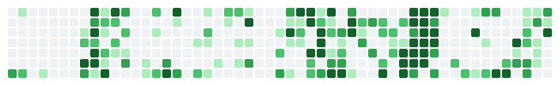

### My Contributions

<picture>
  <source media="(max-width: 900px)" srcset="https://raw.githubusercontent.com/angus123456j/angus123456j/main/hobbit.gif">
  
</picture>

## Angus Lang

### About

I'm a Software Engineering student at the University of Waterloo with interests in AI, computer vision, full-stack development, and interactive systems.

I enjoy exploring new technologies, working through interesting technical challenges, and turning ideas into software people can actually use. I especially like projects that combine technical depth with thoughtful design and a good user experience.

### What I'm Working On

I'm currently exploring machine learning, computer vision, and new ways to build interactive software. I enjoy experimenting with different technologies, learning how things work under the hood, and taking projects beyond their initial prototypes.

### Recent Projects

**[Wildlife Video Analytics](https://github.com/angus123456j/Wild-life-gtstream)**  
An end-to-end animal detection and multi-object tracking pipeline using GStreamer, YOLO, and ByteTrack. Fine-tuned on Alpine wildlife footage and evaluated on 775 official test videos.

<!-- TODO: Upload a screenshot or GIF to images/wildlife.png, then uncomment the line below. -->
<!--  -->

**[Infinite Monkeys](https://github.com/angus123456j/Infinite-Monkeys)**  
An AI-assisted writing editor focused on human control, with contextual rewrites and an interface designed to keep writers in charge of every change.

<!-- TODO: Upload a screenshot or GIF to images/infinite-monkeys.png, then uncomment the line below. -->
<!--  -->

**[WhispyFlow](https://github.com/angus123456j/WispyFlow)**  
A free, privacy-focused Chrome extension for speech-to-text and text-to-speech, powered by locally running open-source AI models.

<!-- TODO: Upload a screenshot or GIF to images/whispyflow.png, then uncomment the line below. -->
<!--  -->

### Contact

[Website](https://www.anguslang.ca) · [LinkedIn](https://www.linkedin.com/in/angus-lang/) · [Email](mailto:a27lang@uwaterloo.ca)

